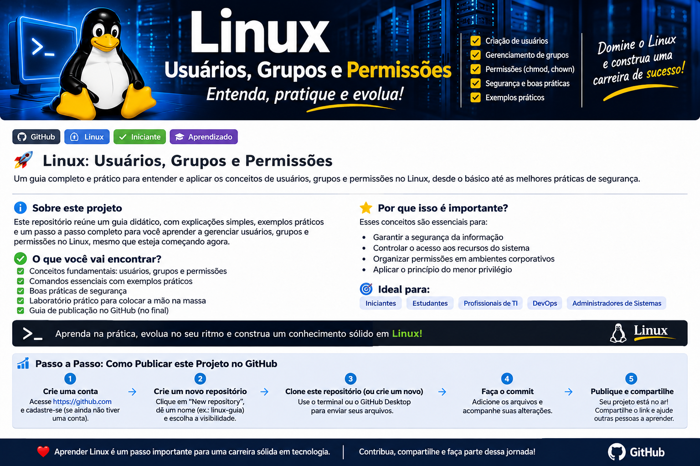

<div align="center">



# 🐧 Linux: Usuários, Grupos e Permissões

### Guia prático para entender, administrar e proteger acessos no Linux.


**Aprenda os conceitos, pratique os comandos e entenda como o controle de acesso é aplicado em ambientes reais.**

</div>

---

## 📌 Sobre este projeto

Este repositório foi criado para quem está começando a estudar Linux e deseja compreender um dos fundamentos mais importantes da administração de sistemas: **o gerenciamento de usuários, grupos e permissões**.

Em servidores, estações de trabalho e ambientes em nuvem, é essencial definir quem pode acessar determinado recurso e quais ações cada pessoa ou serviço pode executar.

O objetivo deste material é explicar os conceitos em linguagem simples, apresentar comandos essenciais e propor um laboratório que pode ser reproduzido em uma máquina virtual ou ambiente Linux de testes.

## 🎯 O que você vai aprender

- O que são usuários, UID, grupos e GID.
- Diferença entre `root`, usuários comuns e contas de serviço.
- Como criar, consultar, modificar e remover usuários e grupos.
- Como interpretar permissões com `ls -l`.
- Como utilizar `chmod`, `chown` e `chgrp`.
- Como funcionam permissões numéricas e simbólicas.
- O que são `umask`, SGID e permissões especiais.
- Como montar um diretório compartilhado para uma equipe.
- Como aplicar o princípio do menor privilégio.

## 📚 Sumário

1. [Por que isso importa nas empresas?](#-por-que-isso-importa-nas-empresas)
2. [Usuários no Linux](#-1-usuários-no-linux)
3. [Grupos no Linux](#-2-grupos-no-linux)
4. [Entendendo as permissões](#-3-entendendo-as-permissões)
5. [Comando chmod](#-4-alterando-permissões-com-chmod)
6. [Proprietário e grupo: chown e chgrp](#-5-alterando-proprietário-e-grupo)
7. [Umask e permissões padrão](#-6-umask-e-permissões-padrão)
8. [Permissões especiais: SGID e sticky bit](#-7-permissões-especiais)
9. [Laboratório prático](#-8-laboratório-prático-diretório-compartilhado)
10. [Boas práticas de segurança](#-9-boas-práticas)
11. [Referência rápida de comandos](#-referência-rápida-de-comandos)
12. [Como publicar este projeto no GitHub](#-como-publicar-este-projeto-no-github)

---

## 🏢 Por que isso importa nas empresas?

Imagine uma empresa com equipes de Financeiro, RH, Comercial e Tecnologia. Cada área precisa acessar determinados arquivos, mas não necessariamente os dados das outras equipes.

Sem um controle adequado, um colaborador poderia visualizar, alterar ou excluir informações que não fazem parte de suas responsabilidades.

O gerenciamento correto de usuários, grupos e permissões ajuda a:

- **Proteger informações:** restringir o acesso a arquivos e diretórios.
- **Organizar equipes:** conceder permissões por departamento ou função.
- **Reduzir riscos:** evitar alterações e exclusões não autorizadas.
- **Apoiar auditorias:** manter uma estrutura de acesso mais clara e administrável.
- **Aplicar o menor privilégio:** conceder apenas os acessos necessários para cada atividade.

Esses fundamentos são utilizados em administração de servidores, infraestrutura, Cloud, DevOps, Segurança da Informação e operações de TI.

---

## 👤 1. Usuários no Linux

Um usuário é uma identidade reconhecida pelo sistema operacional. Pessoas e serviços podem ter contas próprias para executar tarefas.

Cada usuário possui um identificador numérico chamado **UID (User ID)**.

### Tipos comuns de conta

| Tipo | Descrição |
|---|---|
| `root` | Superusuário com privilégios administrativos amplos. |
| Usuário comum | Conta utilizada no dia a dia, com privilégios limitados. |
| Conta de serviço | Identidade utilizada por aplicações e serviços. |

> ⚠️ Evite trabalhar como `root` no dia a dia. Prefira uma conta comum e utilize `sudo` somente quando necessário e autorizado.

### Criar um usuário

Em distribuições baseadas em Debian/Ubuntu:

```bash
sudo adduser joao
```

O `adduser` normalmente conduz uma criação interativa. Outra opção, de baixo nível, é:

```bash
sudo useradd -m joao
sudo passwd joao
```

A opção `-m` solicita a criação do diretório pessoal do usuário. O comportamento padrão do `useradd` pode variar conforme a distribuição e sua configuração.

### Consultar informações

```bash
id joao
```

Exibe UID, GID principal e grupos suplementares.

```bash
getent passwd joao
```

Consulta a entrada da conta nas fontes de usuários configuradas no sistema.

```bash
whoami
```

Mostra o usuário efetivo da sessão atual.

### Alterar ou remover um usuário

```bash
sudo passwd joao
sudo usermod -s /bin/bash joao
sudo userdel joao
```

Para remover também o diretório pessoal e o spool de e-mail local:

```bash
sudo userdel -r joao
```

> ⚠️ A remoção de uma conta pode afetar arquivos e serviços. Verifique dependências e faça isso somente em ambiente autorizado.

---

## 👥 2. Grupos no Linux

Um grupo reúne usuários para facilitar a administração de permissões. Cada grupo possui um identificador chamado **GID (Group ID)**.

Exemplo: uma empresa pode ter grupos como `financeiro`, `rh`, `desenvolvimento` e `infraestrutura`.

### Criar um grupo

```bash
sudo groupadd desenvolvimento
```

### Adicionar um usuário a um grupo suplementar

```bash
sudo usermod -aG desenvolvimento joao
```

**Atenção:** use `-aG`. A opção `-a` adiciona o grupo à lista suplementar existente. Usar `-G` sem `-a` pode substituir essa lista.

### Consultar grupos

```bash
groups joao
id joao
getent group desenvolvimento
```

### Remover um usuário de um grupo

```bash
sudo gpasswd -d joao desenvolvimento
```

### Alterar o grupo principal de um usuário

```bash
sudo usermod -g desenvolvimento joao
```

A alteração do grupo principal afeta a associação padrão de novos arquivos criados pelo usuário. Avalie o impacto antes de executar.

---

## 🔐 3. Entendendo as permissões

No Linux, as permissões tradicionais são organizadas em três classes:

| Classe | Significado |
|---|---|
| `u` — User | Proprietário do arquivo ou diretório. |
| `g` — Group | Grupo associado ao arquivo ou diretório. |
| `o` — Others | Todos os demais usuários. |

E existem três permissões básicas:

| Permissão | Letra | Valor | Em arquivo | Em diretório |
|---|---:|---:|---|---|
| Leitura | `r` | 4 | Ler o conteúdo. | Listar nomes, se também houver acesso ao diretório. |
| Escrita | `w` | 2 | Alterar o conteúdo. | Criar, remover ou renomear entradas, respeitando as demais permissões. |
| Execução | `x` | 1 | Executar o arquivo, se aplicável. | Atravessar/acessar o diretório. |

### Interpretando `ls -l`

Execute:

```bash
ls -l
```

Exemplo de saída:

```text
-rwxr-xr-- 1 joao desenvolvimento 1024 Nov 18 10:00 script.sh
```

Leitura da primeira coluna:

```text
- | rwx | r-x | r--
    u     g     o
```

- `-`: arquivo comum. Um `d` indicaria diretório.
- `rwx`: proprietário pode ler, escrever e executar.
- `r-x`: grupo pode ler e executar.
- `r--`: demais usuários podem somente ler.

---

## 🛠️ 4. Alterando permissões com `chmod`

O comando `chmod` altera as permissões de arquivos e diretórios.

### Forma simbólica

Adicionar leitura ao proprietário:

```bash
chmod u+r arquivo.txt
```

Remover escrita do grupo:

```bash
chmod g-w arquivo.txt
```

Adicionar execução para todas as classes:

```bash
chmod a+x script.sh
```

Definir permissões de forma explícita:

```bash
chmod u=rwx,g=rx,o= arquivo.txt
```

### Forma numérica

Os valores são somados:

- Leitura (`r`) = 4
- Escrita (`w`) = 2
- Execução (`x`) = 1

| Número | Permissões | Significado |
|---:|---|---|
| 7 | `rwx` | Leitura, escrita e execução |
| 6 | `rw-` | Leitura e escrita |
| 5 | `r-x` | Leitura e execução |
| 4 | `r--` | Somente leitura |
| 0 | `---` | Nenhuma permissão |

Exemplos:

```bash
chmod 755 script.sh
chmod 644 documento.txt
chmod 700 arquivo_privado.txt
```

Interpretação de `755`:

- Proprietário: `7` = `rwx`.
- Grupo: `5` = `r-x`.
- Outros: `5` = `r-x`.

Interpretação de `644`:

- Proprietário: `6` = `rw-`.
- Grupo: `4` = `r--`.
- Outros: `4` = `r--`.

> ⚠️ Não use `chmod 777` como solução padrão. Isso concede leitura, escrita e execução a todos e pode expor o sistema a alterações indevidas.

---

## 🧑‍💻 5. Alterando proprietário e grupo

### `chown` — Change Owner

Altera o proprietário de um arquivo:

```bash
sudo chown joao arquivo.txt
```

Altera proprietário e grupo:

```bash
sudo chown joao:desenvolvimento arquivo.txt
```

Aplicar recursivamente a um diretório:

```bash
sudo chown -R joao:desenvolvimento /srv/projetos
```

### `chgrp` — Change Group

Altera somente o grupo proprietário:

```bash
sudo chgrp desenvolvimento arquivo.txt
```

> ⚠️ Use `-R` com cuidado: a alteração recursiva afeta todo o conteúdo do caminho informado.

---

## 🧮 6. Umask e permissões padrão

O `umask` define quais permissões serão retiradas das permissões-base quando novos arquivos e diretórios são criados.

Consultar a configuração atual:

```bash
umask
```

Exemplo comum:

```text
0022
```

De forma simplificada, as bases tradicionais são `666` para arquivos e `777` para diretórios. Com `umask 022`, o resultado típico é:

- Arquivos: `644` (`rw-r--r--`).
- Diretórios: `755` (`rwxr-xr-x`).

Definir a máscara na sessão atual:

```bash
umask 027
```

Com essa máscara, os resultados típicos são arquivos `640` e diretórios `750`.

O resultado efetivo também depende das permissões solicitadas pela aplicação e de mecanismos adicionais, como ACLs.

---

## 🚦 7. Permissões especiais

### SGID em diretórios

O SGID em um diretório faz com que novos arquivos e subdiretórios herdem o grupo proprietário do diretório pai.

Exemplo:

```bash
sudo chmod 2770 /srv/projetos
```

O `2` ativa o SGID; `770` concede acesso completo ao proprietário e ao grupo, sem acesso para outros.

### Sticky bit

É muito utilizado em diretórios compartilhados, como `/tmp`. Em um diretório com sticky bit, usuários comuns normalmente só podem remover ou renomear arquivos que pertencem a eles, respeitadas as demais permissões.

Exemplo:

```bash
sudo chmod 1777 /tmp-exemplo
```

> Permissões especiais exigem atenção. Entenda o efeito antes de aplicá-las em diretórios de produção.

---

## 🧪 8. Laboratório prático: diretório compartilhado

Vamos simular uma equipe chamada `projetos`. O objetivo é permitir que seus integrantes trabalhem em um diretório compartilhado.

**Execute em uma máquina virtual ou ambiente de laboratório, com autorização administrativa.**

### Passo 1 — Criar o grupo

```bash
sudo groupadd projetos
```

### Passo 2 — Criar um usuário

Em Ubuntu/Debian:

```bash
sudo adduser ana
```

### Passo 3 — Adicionar Ana ao grupo

```bash
sudo usermod -aG projetos ana
```

### Passo 4 — Criar o diretório

```bash
sudo mkdir -p /srv/projetos
```

### Passo 5 — Definir proprietário e grupo

```bash
sudo chown root:projetos /srv/projetos
```

### Passo 6 — Configurar as permissões

```bash
sudo chmod 2770 /srv/projetos
```

Com isso:

- `root` é o proprietário.
- `projetos` é o grupo proprietário.
- Proprietário e grupo têm leitura, escrita e acesso ao diretório.
- Outros usuários não têm permissões tradicionais.
- O SGID faz novos itens herdarem o grupo `projetos`.

### Passo 7 — Conferir

```bash
ls -ld /srv/projetos
id ana
```

A saída do diretório deve mostrar permissões semelhantes a:

```text
drwxrws--- root projetos ... /srv/projetos
```

O `s` na posição de execução do grupo indica o SGID.

### Passo 8 — Testar como Ana

```bash
sudo -u ana touch /srv/projetos/teste.txt
ls -l /srv/projetos
```

Se o teste funcionar, Ana conseguiu criar um arquivo no diretório compartilhado.

**Observação:** a associação a um novo grupo pode exigir uma nova sessão de login para aparecer em uma sessão interativa já aberta. O comando `sudo -u` inicia o processo com a identidade solicitada, mas ambientes com políticas específicas podem exigir ajustes adicionais.

### Limpeza opcional do laboratório

Execute somente se quiser desfazer o ambiente de teste:

```bash
sudo rm -rf /srv/projetos
sudo userdel -r ana
sudo groupdel projetos
```

> ⚠️ Confirme cuidadosamente o caminho antes de usar `rm -rf`. Nunca execute esse comando em diretórios que contenham dados importantes.

---

## ✅ 9. Boas práticas de segurança

1. **Princípio do menor privilégio:** conceda somente o acesso necessário.
2. **Evite usar root diretamente:** utilize `sudo` com responsabilidade.
3. **Prefira grupos:** organize permissões por equipe ou função.
4. **Revise acessos periodicamente:** remova contas e associações que não são mais necessárias.
5. **Evite permissões excessivas:** não use `777` sem uma justificativa técnica muito específica.
6. **Cuidado com comandos recursivos:** revise o caminho antes de usar `-R`.
7. **Proteja dados sensíveis:** combine permissões adequadas com políticas de backup, auditoria e controle de acesso.
8. **Teste antes de aplicar em produção:** valide as alterações em um ambiente seguro.

---

## ⌨️ Referência rápida de comandos

| Comando | Finalidade |
|---|---|
| `whoami` | Exibe o usuário atual |
| `id usuario` | Exibe UID, GID e grupos |
| `groups usuario` | Lista os grupos do usuário |
| `adduser usuario` | Cria usuário de forma interativa em sistemas compatíveis |
| `useradd usuario` | Cria usuário |
| `passwd usuario` | Define ou altera senha |
| `usermod -aG grupo usuario` | Adiciona usuário a grupo suplementar |
| `userdel usuario` | Remove usuário |
| `groupadd grupo` | Cria grupo |
| `groupdel grupo` | Remove grupo |
| `gpasswd -d usuario grupo` | Remove usuário do grupo |
| `ls -l` | Lista arquivos com permissões |
| `chmod 755 arquivo` | Altera permissões |
| `chown usuario:grupo arquivo` | Altera proprietário e grupo |
| `chgrp grupo arquivo` | Altera grupo proprietário |
| `umask` | Consulta máscara de permissões |

---

## 🚀 Como publicar este projeto no GitHub

Você pode publicar o material pela interface do GitHub ou pelo terminal. Se estiver começando, siga uma das opções abaixo.

### Opção 1 — Publicar pelo site do GitHub

1. Acesse [https://github.com](https://github.com) e entre na sua conta.
2. Clique em **New repository**.
3. Escolha um nome, por exemplo: `linux-usuarios-grupos-permissoes`.
4. Adicione uma descrição, como: `Guia prático de usuários, grupos e permissões no Linux`.
5. Escolha `Public` se quiser compartilhar o conteúdo com todos.
6. Clique em **Create repository**.
7. No repositório, clique em **Add file → Upload files**.
8. Envie o arquivo `README.md` e a pasta `assets` contendo `capa-linux.png`.
9. Escreva uma mensagem, por exemplo: `Adiciona guia de usuários, grupos e permissões Linux`.
10. Clique em **Commit changes**.

Pronto! O GitHub exibirá o conteúdo do `README.md` na página principal do repositório, incluindo a capa.

### Opção 2 — Publicar pelo terminal com Git

**1. Instale o Git**, se ainda não estiver instalado.

Ubuntu/Debian:

```bash
sudo apt update
sudo apt install git -y
```

**2. Configure sua identificação** (use seu nome e e-mail):

```bash
git config --global user.name "Seu Nome"
git config --global user.email "seu-email@example.com"
```

**3. Baixe ou extraia este projeto** e entre na pasta:

```bash
cd linux-usuarios-grupos-permissoes
```

A estrutura deve ficar assim:

```text
linux-usuarios-grupos-permissoes/
├── README.md
└── assets/
    └── capa-linux.png
```

**4. Inicialize o repositório:**

```bash
git init
```

**5. Adicione os arquivos:**

```bash
git add README.md assets/capa-linux.png
```

**6. Crie o primeiro commit:**

```bash
git commit -m "Adiciona guia de usuarios, grupos e permissoes Linux"
```

**7. Crie um repositório vazio no GitHub**, com o nome `linux-usuarios-grupos-permissoes`.

Não marque a opção para criar outro README, pois o projeto já possui um.

**8. Conecte o repositório local ao GitHub:**

Substitua `SEU_USUARIO` pelo seu nome de usuário do GitHub:

```bash
git branch -M main
git remote add origin https://github.com/SEU_USUARIO/linux-usuarios-grupos-permissoes.git
```

**9. Envie os arquivos:**

```bash
git push -u origin main
```

O GitHub poderá solicitar autenticação. Para HTTPS, utilize um método de autenticação aceito pela sua conta, como Git Credential Manager ou token pessoal; a senha comum da conta não é aceita para operações Git via HTTPS.

**10. Confira seu repositório:**

Acesse:

```text
https://github.com/SEU_USUARIO/linux-usuarios-grupos-permissoes
```

Se o README e a imagem aparecerem, seu projeto foi publicado!

### 🔄 Como enviar futuras atualizações

Depois de modificar algum arquivo:

```bash
git add .
git commit -m "Atualiza conteudo do guia"
git push
```

Esses três comandos fazem parte do fluxo básico de trabalho com Git:

- `git add`: prepara as alterações.
- `git commit`: registra as alterações localmente.
- `git push`: envia os commits para o GitHub.

---

## 📖 Referências para continuar estudando

- [GNU Coreutils — File permissions](https://www.gnu.org/software/coreutils/manual/html_node/File-permissions.html)
- [Ubuntu Server Guide](https://documentation.ubuntu.com/server/)
- [Linux man-pages — useradd](https://man7.org/linux/man-pages/man8/useradd.8.html)
- [Linux man-pages — chmod](https://man7.org/linux/man-pages/man1/chmod.1.html)
- [GitHub Docs — Quickstart for repositories](https://docs.github.com/en/repositories/creating-and-managing-repositories/quickstart-for-repositories)
- [Git Documentation](https://git-scm.com/doc)

---

## 🤝 Contribuição

Este é um projeto educacional e está aberto a melhorias.

Se encontrar algum erro, tiver uma sugestão ou quiser contribuir:

1. Faça um fork do repositório.
2. Crie uma branch para sua melhoria.
3. Faça suas alterações.
4. Abra um Pull Request explicando o que foi melhorado.

## ⭐ Considerações finais

Aprender Linux vai muito além de memorizar comandos. É entender como o sistema organiza recursos, controla acessos e protege informações.

Usuários, grupos e permissões são fundamentos importantes para quem deseja crescer em infraestrutura, Cloud, DevOps e Segurança da Informação.

**Estude. Pratique. Documente sua evolução. Compartilhe conhecimento.**

Se este material ajudou nos seus estudos, deixe uma ⭐ no repositório!

<div align="center">

**🐧 Linux na prática: um comando de cada vez.**

</div>
